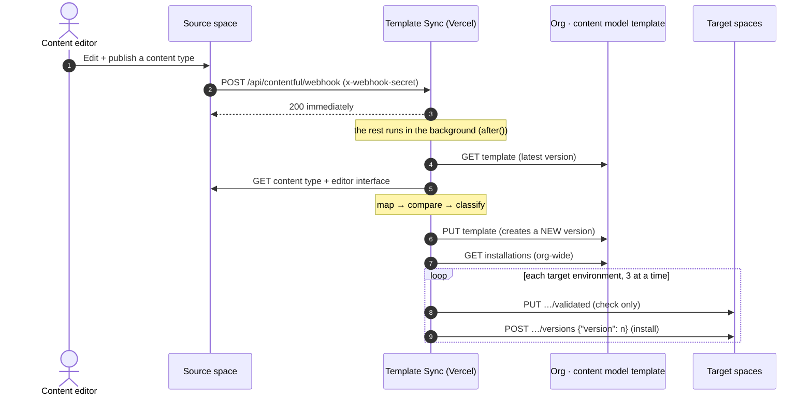

# contentful-template-sync

**Edit a content model once. Every space that uses it updates itself.**

A proof of concept that keeps a Contentful **content model template** in sync with a **source content model**, then rolls each new template version out to every space/environment the template is installed in — triggered by a webhook, with a live dashboard that animates what is happening.

```
 You edit & publish        Contentful              This app                    Contentful
 a content type    ──────▶ webhook      ──────▶   reads → maps →     ──────▶   template gets a new version
 in the SOURCE space       (POST)                 classifies                   ─────▶ installed into every
                                                                                       space that uses it
```

- ✅ **Additive** changes (new field, new validation, renamed label, new widget) roll out **automatically**.
- ✋ **Breaking** changes (field removed, field type changed, field ID renamed) still create the new template version, but the rollout is **held** until a human clicks *Install latest*.
- 👀 A dashboard shows the whole flow live, a before/after of the model, and **every API call** the app makes.

> **Status:** a demo-grade PoC (Next.js on Vercel). No database, no queue, no debounce. See [Limitations](#limitations).

---

## Contents

1. [Quick start](#quick-start-about-20-minutes)
2. [Environment variables](#environment-variables)
3. [How it works — the CMA request flow](#how-it-works--the-cma-request-flow)
4. [The dashboard](#the-dashboard)
5. [Webhook security](#webhook-security)
6. [Troubleshooting](#troubleshooting)
7. [Project layout, scripts, tests](#project-layout)
8. [Keeping secrets out of git](#keeping-secrets-out-of-git)
9. [Limitations](#limitations)

---

## Quick start (about 20 minutes)

You need: **Node 20+**, a **Contentful organization** that has *content model templates*, and (for the live demo) a **Vercel** account.

### Step 1 — Gather five things from Contentful

| You need | What it is | Where to find it |
|---|---|---|
| **Org ID** | The organization that owns the template | Usually visible in the web-app URL while you're in Organization settings (`…/account/organizations/<ORG_ID>/…`), or Organization settings → General |
| **Source space ID** | The space where people *edit* the content model | Space → Settings → General settings |
| **Template ID** | The content model template to keep in sync | Open the template in the Contentful web app (organization-level *Content model templates*); the ID is in its URL / details. You can also list them via the API: `GET /organizations/{org}/environment_templates` |
| **CMA token** | A token that can **edit the template** and **install into the target spaces** | Account settings → *CMA tokens* (personal access token of an org admin/owner), or an organization access token. Menu names move around — search the Contentful docs for "CMA token" |
| **A template made from your model** | A template whose content types are *based on* the source space's content types | Create one from your source content types — see Contentful's *Content model templates* docs. Menu locations change, so search the docs for that name |

> 🔐 The CMA token can modify your org. Treat it like a password: it only ever lives in `.env` (git-ignored) and in Vercel's *sensitive* environment variables.

### Step 2 — Install and configure

```bash
git clone <this repo> contentful-template-sync
cd contentful-template-sync
npm install                # also switches on the pre-commit secret check
cp .env.example .env       # then open .env and fill it in (see the table below)
```

At minimum set `CONTENTFUL_ORG_ID`, `SOURCE_SPACE_ID`, `TEMPLATE_IDS`, `CONTENTFUL_CMA_TOKEN` and `DASHBOARD_PASSWORD` (make one up). Also set `CONTENTFUL_WEBHOOK_SECRET` to a long random string — you'll paste the same value into the webhook in Step 6 (generate one with `openssl rand -base64 24`).

### Step 3 — Check the connection (read-only, safe)

```bash
npm run sync -- --dry-run
```

You should see your template's name and latest version, `No changes` (or the diff that *would* be made), and your target environments. Nothing is written. If it errors, jump to [Troubleshooting](#troubleshooting).

### Step 4 — Run it locally

```bash
npm run dev
```

Open <http://localhost:3000>, log in with `DASHBOARD_PASSWORD`, and click the **API trace** tab to see the real calls. No webhook yet, so changes won't flow automatically — use **Run sync now** to force one.

### Step 5 — Install the template into a test space

A sync updates the template, but there has to be somewhere to roll it out *to*. In the Contentful web app, install your template into **one other space** (not the source space) — see Contentful's *Content model templates* docs for the current menu. The dashboard's *Target environments* table will now list it.

### Step 6 — Deploy to Vercel (so Contentful can reach the webhook)

Contentful can't call `localhost`. Deploy once to get a public URL:

```bash
npm i -g vercel
vercel login
vercel link                       # creates the Vercel project
# add each variable from your .env (mark the secrets sensitive):
vercel env add CONTENTFUL_ORG_ID production
vercel env add SOURCE_SPACE_ID production
vercel env add SOURCE_ENVIRONMENT_ID production
vercel env add TEMPLATE_IDS production
vercel env add AUTO_INSTALL_MODE production
vercel env add CONTENTFUL_CMA_TOKEN production --sensitive
vercel env add CONTENTFUL_WEBHOOK_SECRET production --sensitive
vercel env add DASHBOARD_PASSWORD production --sensitive
vercel deploy --prod
```

Use the **production** URL (e.g. `https://<project>.vercel.app`). Preview URLs may sit behind Vercel's own login, which would block Contentful.

### Step 7 — Create the webhook (in the SOURCE space only)

Source space → **Settings → Webhooks → Add webhook**:

| Field | Value |
|---|---|
| **URL** | `POST` → `https://<project>.vercel.app/api/contentful/webhook` |
| **Triggers** | Select specific events → **Content type → Publish** and **Content type → Delete** (delete is only logged, never propagated) |
| **Filters** | *Environment ID* **equals** `master` (your `SOURCE_ENVIRONMENT_ID`) |
| **Headers** | Add custom header `x-webhook-secret` = the exact value of `CONTENTFUL_WEBHOOK_SECRET` |

Leave Contentful's "request verification" off — the header is the simple way in. (Details in [Webhook security](#webhook-security).)

### Step 8 — Try it 🎉

1. In the **source space**, open a content type that's part of the template and **add a field**. **Save → Publish.**
2. Open the dashboard. Within ~10–30 seconds you'll see the template jump to **v+1**, the flow light up step by step, and the target space go **Installing → Up to date**.
3. Open the **API trace** tab to see every request that made it happen.
4. Now **delete a field** and publish: the version is marked **Breaking** and the target shows **Held** behind a lock until you click **Install latest**.

A talk track for demos is in [`DEMO.md`](./DEMO.md).

---

## Environment variables

| Variable | Required | What it does |
|---|---|---|
| `CONTENTFUL_ORG_ID` | ✅ | Organization that owns the template |
| `SOURCE_SPACE_ID` | ✅ | The only space whose events trigger a sync |
| `SOURCE_ENVIRONMENT_ID` | default `master` | The only environment whose events trigger a sync. Also never a rollout target |
| `TEMPLATE_IDS` | ✅ | Comma-separated template IDs to keep in sync (dashboard shows tabs if more than one) |
| `CONTENTFUL_CMA_TOKEN` | ✅ 🔐 | Org-level CMA token. **Secret** |
| `CONTENTFUL_WEBHOOK_SECRET` | recommended 🔐 | Shared secret the webhook must present. Blank = webhook is open (fine for a throwaway demo). **Secret** |
| `AUTO_INSTALL_MODE` | default `additive-only` | `additive-only`: additive auto-installs, breaking is held · `all`: install everything automatically · `manual`: never auto-install |
| `DASHBOARD_PASSWORD` | ✅ 🔐 | Shared password for the dashboard and its POST routes. **Secret** |

Values are validated with [zod](https://zod.dev) when the server starts; an error names the bad variable but never prints a value.

---

## How it works — the CMA request flow

Everything below talks to the **Contentful Content Management API (CMA)** at `https://api.contentful.com`, authenticated with `Authorization: Bearer <CONTENTFUL_CMA_TOKEN>` (the app uses the `contentful-management` SDK). The **API trace** tab in the dashboard shows these exact calls live.

### The big picture



### Every call, in order

| # | Call | Why | Changes anything? |
|---|---|---|---|
| 1 | `GET /organizations/{org}/environment_templates/{template}` | Read the **current template** (latest version) and its content types | No |
| 2 | `GET /spaces/{source}/environments/{env}/content_types/{ct}` | Read the **source content type** that just changed | No |
| 3 | `GET …/content_types/{ct}/editor_interface` | Read its **editor interface** (field widgets/appearance) | No |
| — | *(in the app)* | **Map → compare → classify** (explained below) | No |
| 4 | `PUT /organizations/{org}/environment_templates/{template}` + header `X-Contentful-Version: <n>` | **Creates a new template version.** Sent only if something actually changed | **Yes** |
| 5 | `GET /organizations/{org}/environment_templates/{template}/template_installations` | List **every space/environment** the template is installed in | No |
| 6 | `PUT /spaces/{s}/environments/{e}/template_installations/{template}/versions/{n}/validated` | **Validate** the new version against one environment. Returns conflicts; installs nothing | No (check only) |
| 7 | `POST /spaces/{s}/environments/{e}/template_installations/{template}/versions` body `{"version": n}` | **Install** the new version (only if step 6 found no conflicts) | **Yes** |
| + | `GET /spaces/{id}` | Look up a space's display name for the dashboard (cached) | No |

### Data mapping: source content type → template content type

A template stores a *simplified copy* of a content type. The app builds it like this (the **Mapping** cards in the API trace show real data):

| Source content type (CMA response) | Template content type (what we PUT) |
|---|---|
| `sys` (id, version, space, environment, users…) | **dropped** — bookkeeping that isn't part of a template |
| `name`, `description`, `displayField` | copied as-is |
| `fields[]` (id, type, validations, required, localized…) | copied **1:1** |
| *(none)* | `id` — kept from the **existing** template content type |
| *(none)* | `basedOn` — link back to the source `space/environment/contentType`, **kept** so the app can find it next time |
| editor interface `controls`, `sidebar`, … | copied 1:1 into an editor-interface template, plus a `contentTypeTemplate` link to the template content type |

Only the changed content type is replaced; everything else in the template body is sent back unchanged.

### Compare, then classify

1. **Compare** — the mapped content type is compared (key-order independent) with what's already in the template. **Identical → nothing is written** (the sync is idempotent, so duplicate webhooks are harmless).
2. **Classify** — otherwise the old and new template bodies are diffed:

| Change | Class | Why |
|---|---|---|
| Field added | ✅ additive | Existing content stays valid |
| Validation / name / required / appearance / widget changed | ✅ additive | Existing content is untouched |
| Content type added | ✅ additive | |
| Field **removed** | ▲ breaking | Data in that field would be lost |
| Field **type** changed (incl. link target / array item type) | ▲ breaking | Existing values may no longer fit |
| Field **ID renamed** (one removed + one added with the same name and type) | ▲ breaking | Looks like a delete + new field |
| Content type removed | ▲ breaking | |

### Roll out: hold or install

- `AUTO_INSTALL_MODE=additive-only` (default): additive → install automatically; **breaking → the new version exists in the template, but nothing is installed** until someone clicks **Install latest** (that click is the approval and ignores the hold).
- For each target (latest installation per space/environment, **never** the source environment): **validate** → if there are conflicts, record them and **skip**; if clean, **install**. Three environments at a time, `429` responses retried with exponential backoff.

### Safety rules baked in

- **Loop guard:** webhook events are ignored unless they come from `SOURCE_SPACE_ID` / `SOURCE_ENVIRONMENT_ID`.
- **Deletes are never propagated:** `ContentType.delete` is logged only.
- **Optimistic locking:** the template `PUT` sends `X-Contentful-Version`; on `409` the app re-reads and retries **once**.
- **Respond fast:** the webhook returns `200` immediately and does the work after the response (`after()`).

### Contentful behaviours worth knowing (we hit all of these)

- **The versions list has no content.** `GET …/environment_templates/{id}/versions` returns metadata only (no `entities`), so the dashboard fetches each version with `GET …?version=n` and caches it (published versions never change).
- **Installations are a history, not a state.** The org-wide installations list returns *one record per install*, so one environment that was upgraded 4 times appears as 4 records. The app keeps the highest version per space/environment (`4 records → 1 target`).
- **`PUT` on the template creates a version.** There is no separate "create version" call; updating the template *is* creating a version. Send `versionName`/`versionDescription` to label it.
- **Validation is a `PUT`** (`…/validated`) but is read-only in effect.
- **Installing is asynchronous.** The installation record goes `created/inProgress → succeeded`; the dashboard shows *Installing…* until it flips.

---

## The dashboard

Open `/` (password-protected). It reads everything live from Contentful — no database — and refreshes every 5 seconds.

| Section | What it shows |
|---|---|
| **Header** | Template name, latest version, when it was created, source, rollout mode, **Run sync now** |
| **How a change flows** | `Source model → Webhook → Template → Installs`, animated. Glowing dots travel while installing; a purple 🔒 shows a held breaking change. Plays a ripple whenever a new version lands (or press **Replay**) |
| **What changed in the model** | Before → After fields for the changed content type. Added = green, changed = amber, removed = red strikethrough |
| **Target environments** | Space, environment, installed version, status badge (*Up to date / Behind / Held / Conflict / Installing / Failed*) and an **Install latest** button |
| **Version history** | Each version, classified additive/breaking, with the change list |
| **API trace** (tab) | Every CMA call: method, URL, what was **sent**, what came **back**, status and timing, plus the mapping and decision steps. **Trace a dry run** is read-only; **Run sync now** / **Install latest** record their real calls |

**Rehearse without touching Contentful:** `/?preview=installing`, `/?preview=held` or `/?preview=behind` overlay *simulated* states (with an amber banner; nothing is written).

> Webhook-triggered runs happen in a separate serverless instance and the app keeps no database, so they don't appear in the API trace tab. They are logged to Vercel instead: look for `webhook.trace` lines (one per call).

---

## Webhook security

The endpoint accepts a request if **any one** of these matches `CONTENTFUL_WEBHOOK_SECRET`:

1. **Custom header** `x-webhook-secret: <secret>` *(recommended — what Step 7 sets up)*
2. **HTTP Basic Auth** — any username, the secret as the password (Contentful's webhook form has a Basic Auth option)
3. **Contentful request verification** — if you enable it in the source space, signed requests are verified too

If `CONTENTFUL_WEBHOOK_SECRET` is blank the endpoint is open. The sync is idempotent and never trusts the webhook body (it re-reads the real content type from Contentful), so a forged call can't inject a model — but keep the secret set anyway.

The dashboard and its POST routes (`/api/sync`, `/api/install`, `/api/trace`, `/api/status`) are protected by `DASHBOARD_PASSWORD` (a signed cookie; the password itself is never stored in the browser).

---

## Troubleshooting

| Symptom | Likely cause / fix |
|---|---|
| App won't start: `Invalid environment configuration — …` | A required `.env` variable is missing; the message names which one |
| `npm run sync -- --dry-run` → `401` / `AccessTokenInvalid` | Wrong or expired `CONTENTFUL_CMA_TOKEN`, or the token's owner can't see the org/space |
| `403` / `AccessDenied` on the template | The token's owner isn't allowed to edit templates in that org |
| `404` on the template | Wrong `CONTENTFUL_ORG_ID` or `TEMPLATE_IDS` |
| Dry run says *"not part of the template"* | The template's content types aren't *based on* the source space's content types (`basedOn` link missing) |
| Nothing happens when I publish | Check the webhook's **Activity log** in Contentful. `401` = header value ≠ `CONTENTFUL_WEBHOOK_SECRET` (also check Vercel has the same value, then redeploy). No entry at all = wrong URL, wrong trigger, or the environment filter doesn't match |
| Webhook shows `200` but the template didn't change | Look in Vercel logs for `webhook.trace` / `webhook.done`. "identical" means the template already matched the source |
| Target stuck on **Held** | A breaking change is waiting — review it, then **Install latest** |
| Target shows **Conflict** | Validation found something (e.g. a content type already exists in the target with different settings). The trace tab shows the exact finding |
| Dashboard keeps redirecting to `/login` | Wrong password, or cookies blocked (the cookie is `SameSite=None; Secure` in production so it works in an iframe) |

---

## Project layout

```
src/
  app/
    page.tsx                      Dashboard page (server-rendered first load)
    login/page.tsx                Password form
    api/contentful/webhook/       ← Contentful calls this
    api/sync|install|trace|status Dashboard actions (password-protected)
  components/                     Dashboard, Pipeline (animated flow), ChangeDiff, TraceView
  lib/
    template.ts                   Reads, source→template mapping, the sync + template PUT
    classify.ts                   Pure additive/breaking classifier
    installations.ts              Org-wide installations → de-duplicated targets
    rollout.ts                    validate → install, concurrency, backoff, hold policy
    sync.ts                       Orchestration (sync, then roll out) + dry-run trace
    trace.ts / trace-types.ts     Records every API call for the API trace tab
    webhook.ts                    Webhook auth + topic handling
    dashboard-data.ts             Builds the dashboard (status badges, before/after diff)
    config.ts                     zod-validated env
  proxy.ts                        Password gate (Next.js 16 "proxy", formerly middleware)
scripts/
  sync.ts                         CLI: npm run sync [-- --dry-run]
  check-secrets.mjs               Blocks commits that contain secrets
tests/                            vitest
```

### Scripts

```bash
npm run dev                       # local dev server
npm run build && npm start        # production build
npm run sync -- --dry-run         # print the diff + targets, write nothing
npm run sync                      # real sync (same as "Run sync now")
npm test                          # vitest (classifier, dedupe, webhook auth, diff, trace)
npm run typecheck && npm run lint
npm run check:secrets             # scan the repo for secrets
```

---

## Keeping secrets out of git

- `.env` (and every `.env*` except `.env.example`) is in `.gitignore`. `.vercel/` is ignored too.
- `npm install` turns on a **pre-commit hook** (`.githooks/pre-commit`) that runs `scripts/check-secrets.mjs --staged`. It blocks a commit if any staged file contains a value from your local `.env` (token, webhook secret, password, org/space/template IDs), a token-shaped string (e.g. `CFPAT-…`), or an env file.
- You can run it anytime: `npm run check:secrets`. It only prints file names and variable names — never values.
- Secrets in Vercel are stored as **sensitive** environment variables. If a token is ever exposed, revoke it in Contentful and create a new one.

---

## Limitations

- **No debounce.** A publish followed by an editor-interface save can trigger two syncs. They're idempotent and race-safe (`409` → retry), but you may occasionally see an extra template version.
- **Field renames** are detected heuristically (same name + type, new ID). Anything else shows as remove + add, which is also *breaking*.
- **Editor-interface-only changes** (appearance) don't fire `ContentType.publish`; they're picked up the next time a content type is published or **Run sync now** is used. (The `EditorInterface.save` topic is handled by the endpoint if your webhook UI exposes it.)
- **In-memory caches** (validation results for 30 s, version bodies) are per server instance.
- **One shared password**, not user identity. Don't expose the dashboard more widely than a demo needs.
- **Template versions are append-only.** Every real change creates a new version.
